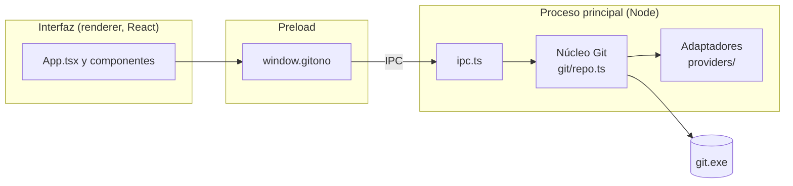

# Arquitectura de GitOno

## Tecnologías

| Parte | Elección | Por qué |
|---|---|---|
| App de escritorio | Electron | Todo el proyecto en TypeScript; acceso a Git y al sistema de archivos. |
| Compilación | electron-vite (Vite) | Un solo comando para los tres procesos de Electron, con recarga en caliente. |
| Interfaz | React | Componentes simples y ecosistema conocido. |
| Visor de diferencias | Monaco Editor | Es el editor de VS Code: diff lado a lado, resaltado de sintaxis, textos en español. Se carga desde `node_modules`, sin CDN, así funciona sin internet. |
| Git | El `git` instalado en la máquina | Es la implementación de referencia: soporta todo (renombres, LFS, credenciales) sin reimplementar nada. |
| Tests | Vitest | Rápido y compatible con Vite. |

## Los tres procesos de Electron



- **Interfaz (renderer):** React. No tiene acceso a Node ni al disco; solo puede llamar a `window.gitono`.
- **Preload:** expone una API chica y tipada (`GitOnoApi` en `src/shared/types.ts`) usando `contextBridge`.
- **Proceso principal:** recibe los pedidos por IPC, ejecuta Git y devuelve el resultado.

Los errores viajan como `{ ok: false, error }` y el preload los vuelve a lanzar como `Error` con un mensaje legible, así la interfaz los muestra tal cual.

### Seguridad

- `contextIsolation: true`, `nodeIntegration: false` y `sandbox: true`: la interfaz no puede ejecutar código de Node.
- Política de seguridad de contenido (CSP) en `index.html`: solo se cargan scripts propios.
- Git se ejecuta con `execFile` (sin shell) y cada referencia se valida con `assertSafeRef`, para que un nombre como `--output=x` no se interprete como una opción.
- Los links externos se abren en el navegador del sistema, nunca dentro de la app.

## Capas del proceso principal

### Núcleo Git (`src/main/git/`)

Todo lo que funciona igual con cualquier plataforma. No depende de Electron, así que se puede testear con Node puro.

| Función | Comando Git | Para qué |
|---|---|---|
| `openRepo` | `git rev-parse --show-toplevel`, `git remote get-url` | Encontrar la raíz del repo y su remoto. |
| `listRefs` | `git for-each-ref refs/heads refs/remotes refs/tags` | Listar ramas y tags con el commit al que apunta cada uno. |
| `listRefs` | `git symbolic-ref -q HEAD`, `git rev-parse HEAD^{commit}` | Saber en qué rama y en qué commit está parado el repo. |
| `listCommits` | `git log --branches --remotes --tags HEAD --date-order` | Historial para el gráfico, por tandas (`--max-count`). |
| `commitDetails` | `git show -s SHA^{commit}` | Mensaje completo, autor y quién hizo el commit. |
| `commitDetails` | `git diff-tree -r -z -M PADRE SHA` (o `--root SHA`) | Archivos que cambió el commit, respecto de su primer padre. |
| `compareRefs` | `git diff --name-status -z -M A B` | Archivos cambiados y su estado (con detección de renombres). |
| `compareRefs` | `git diff --numstat -z -M A B` | Líneas agregadas y borradas, y qué archivos son binarios. |
| `compareRefs` | `git rev-list --left-right --count A...B` | Cuántos commits tiene cada rama que la otra no. |
| `readFileAtRef` | `git cat-file -s` y `git cat-file blob A:ruta` | Leer un archivo tal como está en una rama, sin checkout. |
| `fetchAll` | `git fetch --all --prune` | Traer ramas nuevas del servidor. |

Decisiones:

- **Se compara A contra B directamente** (`git diff A B`), no contra el ancestro común. La pregunta que responde es "¿en qué se diferencian hoy estas dos ramas?", como comparar dos carpetas.
- **Se usan nombres completos** (`refs/heads/main`) al hablar con Git; los cortos (`main`) solo se muestran. Así no hay ambigüedad si una rama y un tag se llaman igual.
- **Salida con `-z`** (separador NUL): las rutas con espacios, tildes o caracteres especiales llegan tal cual, sin comillas ni escapes.
- **Archivos binarios:** si hay un byte NUL al principio se tratan como binarios (mismo criterio que Git) y no se muestran como texto.
- **Archivos grandes:** más de 5 MB no se cargan en el visor (`MAX_FILE_BYTES`).
- **Credenciales:** `fetch` usa el Git Credential Manager que trae Git para Windows. Se desactiva el pedido de contraseña por terminal (`GIT_TERMINAL_PROMPT=0`) porque la app no tiene terminal.
- **Historial:**
  - se usa `--date-order`, que muestra los hijos siempre antes que sus padres y respeta la fecha, como GitKraken;
  - en vez de `--all` se listan ramas, remotas, tags y HEAD, para que los stashes no aparezcan como commits sueltos;
  - `--no-show-signature` evita que la verificación de firmas GPG se mezcle con la salida si el usuario la tiene activada.
- **Detalle de un commit:**
  - se pide `SHA^{commit}` para que también funcione si llega el SHA de un tag anotado;
  - los merges se comparan contra su primer padre, igual que GitKraken y GitHub.

### Cambios locales (`src/main/git/worktree.ts`)

| Función | Comando Git | Para qué |
|---|---|---|
| `workingStatus` | `git --no-optional-locks status --porcelain=v2 --branch -z` | Archivos preparados, sin preparar, nuevos y con conflictos. |
| `readSource` | `git cat-file blob :ruta` o lectura del disco | Leer un archivo del índice o de la carpeta de trabajo. |
| `workingDiff` | `git diff [--cached] --src-prefix=a/ --dst-prefix=b/` | Diff de un archivo en el formato que entiende `git apply`. |
| `stageFiles` / `unstageFiles` | `git add -A`, `git restore --staged` (o `git rm --cached` sin commits) | Preparar o quitar archivos enteros. |
| `restoreWorktree` | `git restore --worktree` | Descartar cambios sin preparar. |
| `applyPatch` | `git apply --recount [--cached] [--reverse] -` | Preparar, quitar o descartar bloques o líneas. |
| `commit` | `git commit --file=- --cleanup=whitespace [--amend]` | Hacer o enmendar un commit. |

Decisiones:

- **`--no-optional-locks` en `status`:** sin esa opción, `git status` puede reescribir el índice. La app vería ese cambio en el disco, volvería a pedir el estado y entraría en un ciclo.
- **Rutas por la entrada estándar:** `--pathspec-from-file=- --pathspec-file-nul` evita el límite de largo de la línea de comandos de Windows (unos 32.000 caracteres) al preparar muchos archivos, y los problemas con nombres raros.
- **Mensaje del commit por la entrada estándar** (`--file=-`), con `--cleanup=whitespace` para respetar las líneas que empiezan con `#` (por ejemplo `#123 corrige el login`).
- **Prefijos fijos en el diff** (`a/` y `b/`): si el usuario tiene `diff.noprefix` o `diff.mnemonicPrefix` configurados, el parche igual se puede aplicar.
- **Archivos nuevos que se descartan:** van a la papelera de reciclaje (`shell.trashItem`, en `ipc.ts`), así se pueden recuperar. Los cambios en archivos con seguimiento no se pueden recuperar, y la interfaz siempre pide confirmación.
- **Rutas siempre dentro del repo:** `insideRepo` rechaza rutas como `../x` o absolutas antes de leer o mandar a la papelera.

### Parches por bloque y por línea (`src/shared/patch.ts`)

`parseFileDiff` lee la salida de `git diff` de un archivo. `buildPatch` arma un parche solo con las líneas elegidas. Está en `shared/` porque lo usa la interfaz (para armar el parche) y lo prueban los tests del núcleo contra repos reales.

- **Para preparar** (el parche se aplica tal cual al índice): una línea agregada que no se eligió se saca del parche, y una borrada que no se eligió pasa a ser contexto, porque sigue estando.
- **Para quitar o descartar** (el parche se aplica al revés): es lo contrario. Una agregada que no se eligió pasa a ser contexto y una borrada que no se eligió se saca.
- **`--recount`:** se aplica con esa opción para que Git recalcule los números de cada bloque.
- **Diff viejo:** si el archivo cambió entre que se mostró el diff y se aplicó la acción, `git apply` falla sin tocar nada (lo verifica un test), y la app muestra el error.
- **Finales de línea de Windows:** se conserva el `\r` de cada línea, y Git convierte los finales al aplicar. Hay un test con `core.autocrlf=true`.
- **Solo archivos modificados:** por ahora, preparar por línea se ofrece solo en archivos modificados. Los nuevos, borrados o renombrados se manejan enteros.

### Vigilancia del disco (`src/main/git/watch.ts`)

Un `fs.watch` recursivo sobre la carpeta del repo avisa a la interfaz por el canal `repo:changed`:

- **`worktree`:** cambió un archivo del proyecto o `.git/index`. Se relee solo el estado.
- **`refs`:** cambió `.git/HEAD`, `.git/refs/…` o `packed-refs`. Se releen ramas, historial y estado.
- **Se ignora:** los `.lock` (son temporales de Git), `objects/` y `logs/`.
- **Ráfagas:** los cambios se agrupan. El aviso sale 300 ms después del primero de una ráfaga, aunque sigan llegando más; durante algo largo, como un `npm install`, la app se sigue actualizando cada tanto.
- **Al volver a la ventana** también se relee el estado.

### Adaptadores de plataforma (`src/main/providers/`)

Cada plataforma implementa la interfaz `GitProvider` (`providers/types.ts`). El resto de la app solo conoce esa interfaz.

- `remote-url.ts` entiende las URLs de remoto (`https://`, `ssh://` y `git@host:ruta`) y extrae el host y la ruta del repo (incluidos los subgrupos de GitLab).
- `github.ts` y `gitlab.ts` deciden si un host les pertenece. GitLab también reconoce instancias propias con "gitlab" en el dominio (por ejemplo `gitlab.empresa.com`).
- Si ningún adaptador reconoce el host, el repo se marca como `generic`: todo lo local funciona igual.

Hoy los adaptadores solo identifican la plataforma. En la etapa de plataformas ([hoja de ruta](roadmap.md), etapa 5) la interfaz va a sumar operaciones contra la API de cada una, con la misma firma para todas:

```ts
listBranches(repo): Promise<Branch[]>
compare(repo, base, head): Promise<FileChange[]>
getFile(repo, ref, path): Promise<string>
listChangeRequests(repo): Promise<ChangeRequest[]> // PR en GitHub, MR en GitLab
```

#### Cómo sumar una plataforma nueva

1. Crear `src/main/providers/<plataforma>.ts` que exporte un objeto `GitProvider`.
2. Agregarlo a la lista `providers` en `src/main/providers/index.ts`.
3. Sumar casos en `providers.test.ts`.

## Interfaz (`src/renderer/src/`)

- `App.tsx`: repo abierto, referencias, pestañas, botón de fetch y avisos de error. Las dos vistas quedan montadas (se ocultan con `hidden`), así al cambiar de pestaña no se pierde lo que estabas mirando. Se suscribe a los avisos de cambios en el disco y maneja dos contadores: `reloadKey` (ramas e historial: fetch, commit, cambios en `.git/refs`) y `statusKey` (carpeta de trabajo).
- `views/HistoryView.tsx`: pestaña Historial. Panel de ramas, lista de commits con la fila WIP, búsqueda y panel derecho, que muestra el detalle del commit o, con la fila WIP elegida, el panel de preparación. Cuando un archivo local abierto se prepara entero, la vista pasa a mostrarlo como preparado; si ya no tiene cambios, vuelve al gráfico.
- `components/WorkingTreePanel.tsx`: archivos sin preparar, preparados y con conflictos, y la caja de commit. El borrador del mensaje vive en `HistoryView`, así no se pierde al mirar otro commit.
- `components/WorkingFileView.tsx`: un archivo local en el centro, por bloques (`HunkView`) o lado a lado (`DiffView` con el índice o la carpeta de trabajo como origen).
- `components/HunkView.tsx`: bloques del diff con sus botones y selección de líneas.
- `views/CompareView.tsx`: pestaña Comparar ramas.
- `components/CommitList.tsx`: lista de commits **virtualizada**. Solo dibuja las filas visibles (más un margen), así 20.000 commits se mueven igual de rápido que 20. Al acercarse al final pide otra tanda de 1.000.
- `components/CommitGraphCell.tsx`: el gráfico de una fila, en SVG.
- `components/RefsPanel.tsx`: ramas locales, remotas agrupadas por remoto y tags.
- `components/CommitDetails.tsx`: detalle del commit elegido.
- `components/RefSelect.tsx`: selector de rama agrupado en locales, remotas y tags.
- `components/FileTree.tsx`: árbol de archivos cambiados. Las carpetas con un solo hijo se compactan (`src/main/git`), como en VS Code.
- `components/DiffView.tsx`: visor Monaco. El editor se crea una sola vez; al cambiar de archivo solo se reemplazan los modelos, así no parpadea.
- `monaco.ts`: configuración de Monaco (workers locales, idioma español, sin validaciones porque es de solo lectura, tema según Windows).
- `lib/refs.ts`: arma las etiquetas de cada commit y junta una rama local con su remota cuando apuntan al mismo commit.
- `lib/settings.ts`: preferencias guardadas (ancho del panel, opciones del diff, pestaña). Si el almacenamiento falla, se usan los valores por defecto.

Los estados de archivo usan símbolos (+, −, ~, →) en lugar de las letras de Git (A, M, D) para no confundirlos con "rama A" y "rama B".

### Cómo se dibuja el gráfico (`lib/graph.ts`)

Los commits llegan de más nuevo a más viejo. Se mantiene una lista de **carriles** (columnas), y cada carril "espera" a un commit: el próximo que va a aparecer en esa columna.

1. Si algún carril espera al commit, el commit va en el primero de ellos. Los otros carriles que también lo esperaban convergen en él con una curva, por ejemplo cuando dos ramas salieron del mismo punto.
2. Si ningún carril lo espera, es la punta de una rama: abre un carril nuevo con un color nuevo.
3. Después, el carril pasa a esperar al **primer padre** y mantiene su color. Los otros padres (en un merge) se suman a un carril que ya los esperaba, o abren uno nuevo.
4. Los carriles que quedan libres se reutilizan, y los vacíos del final se recortan para que el gráfico no crezca de más.

Cada fila guarda sus líneas en dos mitades: de arriba al nodo y del nodo hacia abajo. Así cada fila se dibuja sola, que es lo que necesita la lista virtualizada. El cálculo es lineal en la cantidad de commits: 20.000 se procesan al instante.

## Tests

- `git/parse.test.ts`: parsers de la salida de Git.
- `git/repo.test.ts`: crea un repo real en una carpeta temporal, con dos ramas, y prueba el núcleo completo (renombres, binarios, archivos borrados, referencias inválidas).
- `git/log.test.ts`: historial y detalle de commits contra un repo real con merge y tag anotado. Prueba el orden, los límites, el primer commit, los merges y los repos vacíos. Usa fechas fijas para que el orden sea predecible.
- `git/worktree.test.ts`: cambios locales contra repos reales, entre ellos:
  - estado;
  - preparar, quitar y descartar archivos;
  - preparar, quitar y descartar bloques y líneas sueltas;
  - parches viejos;
  - `core.autocrlf=true` con CRLF;
  - commit en un repo vacío y enmendar.
- `git/watch.test.ts`: clasificación de cambios en el disco y agrupado de ráfagas.
- `shared/patch.test.ts`: lectura de diffs y armado de parches parciales (también "sin salto de línea al final").
- `providers/providers.test.ts`: lectura de URLs y detección de plataforma.
- `renderer/src/lib/graph.test.ts`: carriles del gráfico (historia lineal, merges, ramas que nacen del mismo commit, carriles reutilizados, fila WIP punteada).
- `renderer/src/lib/refs.test.ts`: etiquetas de cada commit.
- `renderer/src/lib/tree.test.ts`: armado del árbol de archivos.

## Distribución

- `npm run dist` compila con electron-vite y empaqueta con electron-builder (`electron-builder.yml`). Genera un instalador NSIS en `dist/`.
- **La carpeta de instalación es fija** (`%LOCALAPPDATA%\Programs\GitOno`). El desinstalador de electron-builder hace `RMDir /r` de la carpeta de instalación, y al actualizar, el instalador ejecuta primero el desinstalador de la versión anterior. Si se dejara elegir la carpeta y coincidiera con una carpeta con otros archivos (por ejemplo, la del proyecto), se borraría entera.
- Al instalador solo entra `out/` y el `package.json`. React y Monaco están en `devDependencies` porque Vite ya los incluye en `out/renderer`; así no se copian dos veces y el `app.asar` pesa unos 24 MB.
- La app empaquetada carga la interfaz desde `app.asar` con `file://`. Los workers de Monaco funcionan ahí sin configuración extra.
- El ícono sale de `build/icon.svg`. electron-builder usa `build/icon.png` (512 × 512, fondo transparente) para generar el `.ico`. Si se cambia el SVG, hay que volver a exportar el PNG.
- Sin firma digital ni actualización automática por ahora.
