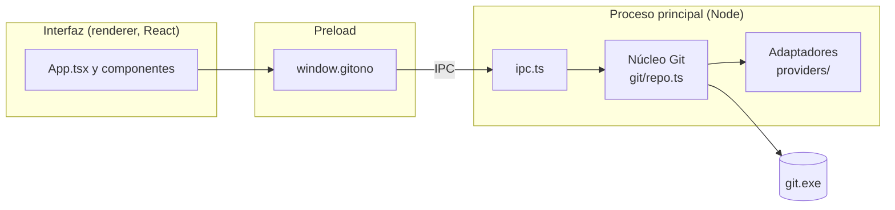

# Arquitectura de GitOno

## Tecnologías

| Parte | Elección | Por qué |
|---|---|---|
| App de escritorio | Electron | Todo el proyecto en TypeScript; acceso a Git y al sistema de archivos. |
| Compilación | electron-vite (Vite) | Un solo comando para los tres procesos de Electron, con recarga en caliente. |
| Interfaz | React | Componentes simples y ecosistema conocido. |
| Visor de diferencias | Monaco Editor | Es el editor de VS Code: diff lado a lado, resaltado de sintaxis, textos en español. Se carga desde `node_modules`, sin CDN, así funciona sin internet. |
| Git | El `git` instalado en la máquina | Es la implementación de referencia: soporta todo (renombres, LFS, credenciales) sin reimplementar nada. |
| Tests | Vitest | Rápido y compatible con Vite. |

## Los tres procesos de Electron



- **Interfaz (renderer):** React. No tiene acceso a Node ni al disco; solo puede llamar a `window.gitono`.
- **Preload:** expone una API chica y tipada (`GitOnoApi` en `src/shared/types.ts`) usando `contextBridge`.
- **Proceso principal:** recibe los pedidos por IPC, ejecuta Git y devuelve el resultado.

Los errores viajan como `{ ok: false, error }` y el preload los vuelve a lanzar como `Error` con un mensaje legible, así la interfaz los muestra tal cual.

### Varias ventanas

- `index.ts` crea cada ventana con un `WindowStart` (`repoPath` y `restoreTabs`), que la interfaz pide con `windowStart()`. Solo la primera recupera y guarda las pestañas de la última vez; las que se abren con `newWindow()` (Ctrl+Shift+N, "Abrir en una ventana nueva") empiezan vacías o con un repo.
- Las ventanas comparten las preferencias (`localStorage`): cuando una cambia la apariencia o los perfiles, las demás se enteran por el evento `storage`.
- Los repos vigilados son de cada ventana (clave `id de la ventana|carpeta`), así dos ventanas pueden tener el mismo repo, y cerrar una deja de vigilar solo los suyos.
- `editMenu.ts`: menú de clic derecho para copiar, cortar y pegar sobre texto seleccionado o en campos (Electron no trae ninguno). Los menús propios de la app y el de Monaco cancelan el evento y no llegan hasta ahí.

### Idioma (`src/shared/i18n.ts`)

- Estilo gettext: el texto en español es la clave. `t('Rama {name} creada.', { name })` devuelve el español o busca la traducción en `i18n.en.ts`; `tn(n, singular, plural)` elige la forma y formatea el número; `tr()` (`renderer/src/lib/i18n.tsx`) acepta elementos de React como variables (negritas, código, enlaces).
- Lo comparten el proceso principal (errores de Git y diálogos nativos, que siguen el idioma con `setLocale` por IPC) y la interfaz.
- La interfaz fija el idioma antes de cargar el resto (`lib/locale.ts` es el primer import de `main.tsx`), porque hay textos que se arman al cargar cada módulo (columnas, temas, disposiciones). Por eso cambiar de idioma recarga la ventana; las pestañas se recuperan solas.
- `main/i18n.test.ts` recorre el código, junta cada texto de `t`, `tn` y `tr`, y falla si falta su traducción o si las variables `{…}` no coinciden.
- Los términos de cada idioma están en `docs/glosario.md`.

### Seguridad

- `contextIsolation: true`, `nodeIntegration: false` y `sandbox: true`: la interfaz no puede ejecutar código de Node.
- Política de seguridad de contenido (CSP) en `index.html`: solo se cargan scripts propios.
- Git se ejecuta con `execFile` (sin shell) y cada referencia se valida con `assertSafeRef`, para que un nombre como `--output=x` no se interprete como una opción.
- Los links externos se abren en el navegador del sistema, nunca dentro de la app.

## Capas del proceso principal

### Núcleo Git (`src/main/git/`)

Todo lo que funciona igual con cualquier plataforma. No depende de Electron, así que se puede testear con Node puro.

| Función | Comando Git | Para qué |
|---|---|---|
| `openRepo` | `git rev-parse --show-toplevel`, `git remote get-url` | Encontrar la raíz del repo y su remoto. |
| `listRefs` | `git for-each-ref refs/heads refs/remotes refs/tags` | Listar ramas y tags con el commit al que apunta cada uno. |
| `listRefs` | `git symbolic-ref -q HEAD`, `git rev-parse HEAD^{commit}` | Saber en qué rama y en qué commit está parado el repo. |
| `listCommits` | `git log --branches --remotes --tags HEAD --date-order` | Historial para el gráfico, por tandas (`--max-count`). |
| `commitDetails` | `git show -s SHA^{commit}` | Mensaje completo, autor y quién hizo el commit. |
| `commitDetails` | `git diff-tree -r -z -M PADRE SHA` (o `--root SHA`) | Archivos que cambió el commit, respecto de su primer padre. |
| `compareRefs` | `git diff --name-status -z -M A B` | Archivos cambiados y su estado (con detección de renombres). |
| `compareRefs` | `git diff --numstat -z -M A B` | Líneas agregadas y borradas, y qué archivos son binarios. |
| `compareRefs` | `git rev-list --left-right --count A...B` | Cuántos commits tiene cada rama que la otra no. |
| `readFileAtRef` | `git cat-file -s` y `git cat-file blob A:ruta` | Leer un archivo tal como está en una rama, sin checkout. |
| `fetchAll` | `git fetch --all --prune` | Traer ramas nuevas del servidor. |

Decisiones:

- **Se compara A contra B directamente** (`git diff A B`), no contra el ancestro común. La pregunta que responde es "¿en qué se diferencian hoy estas dos ramas?", como comparar dos carpetas.
- **Se usan nombres completos** (`refs/heads/main`) al hablar con Git; los cortos (`main`) solo se muestran. Así no hay ambigüedad si una rama y un tag se llaman igual.
- **Salida con `-z`** (separador NUL): las rutas con espacios, tildes o caracteres especiales llegan tal cual, sin comillas ni escapes.
- **Archivos binarios:** si hay un byte NUL al principio se tratan como binarios (mismo criterio que Git) y no se muestran como texto.
- **Archivos grandes:** más de 5 MB no se cargan en el visor (`MAX_FILE_BYTES`).
- **Credenciales:** `fetch` usa el Git Credential Manager que trae Git para Windows. Se desactiva el pedido de contraseña por terminal (`GIT_TERMINAL_PROMPT=0`) porque la app no tiene terminal.
- **Historial:**
  - se usa `--date-order`, que muestra los hijos siempre antes que sus padres y respeta la fecha, como GitKraken;
  - en vez de `--all` se listan ramas, remotas, tags y HEAD, para que los stashes no aparezcan como commits sueltos;
  - `--no-show-signature` evita que la verificación de firmas GPG se mezcle con la salida si el usuario la tiene activada.
- **Detalle de un commit:**
  - se pide `SHA^{commit}` para que también funcione si llega el SHA de un tag anotado;
  - los merges se comparan contra su primer padre, igual que GitKraken y GitHub.

### Cambios locales (`src/main/git/worktree.ts`)

| Función | Comando Git | Para qué |
|---|---|---|
| `workingStatus` | `git --no-optional-locks status --porcelain=v2 --branch -z` | Archivos preparados, sin preparar, nuevos y con conflictos. |
| `readSource` | `git cat-file blob :ruta` o lectura del disco | Leer un archivo del índice o de la carpeta de trabajo. |
| `workingDiff` | `git diff [--cached] --src-prefix=a/ --dst-prefix=b/` | Diff de un archivo en el formato que entiende `git apply`. |
| `stageFiles` / `unstageFiles` | `git add -A`, `git restore --staged` (o `git rm --cached` sin commits) | Preparar o quitar archivos enteros. |
| `restoreWorktree` | `git restore --worktree` | Descartar cambios sin preparar. |
| `applyPatch` | `git apply --recount [--cached] [--reverse] -` | Preparar, quitar o descartar bloques o líneas. |
| `commit` | `git commit --file=- --cleanup=whitespace [--amend]` | Hacer o enmendar un commit. |

Decisiones:

- **`--no-optional-locks` en `status`:** sin esa opción, `git status` puede reescribir el índice. La app vería ese cambio en el disco, volvería a pedir el estado y entraría en un ciclo.
- **Rutas por la entrada estándar:** `--pathspec-from-file=- --pathspec-file-nul` evita el límite de largo de la línea de comandos de Windows (unos 32.000 caracteres) al preparar muchos archivos, y los problemas con nombres raros.
- **Mensaje del commit por la entrada estándar** (`--file=-`), con `--cleanup=whitespace` para respetar las líneas que empiezan con `#` (por ejemplo `#123 corrige el login`).
- **Prefijos fijos en el diff** (`a/` y `b/`): si el usuario tiene `diff.noprefix` o `diff.mnemonicPrefix` configurados, el parche igual se puede aplicar.
- **Archivos nuevos que se descartan:** van a la papelera de reciclaje (`shell.trashItem`, en `ipc.ts`), así se pueden recuperar. Los cambios en archivos con seguimiento no se pueden recuperar, y la interfaz siempre pide confirmación.
- **Rutas siempre dentro del repo:** `insideRepo` rechaza rutas como `../x` o absolutas antes de leer o mandar a la papelera.

### Parches por bloque y por línea (`src/shared/patch.ts`)

`parseFileDiff` lee la salida de `git diff` de un archivo. `buildPatch` arma un parche solo con las líneas elegidas. Está en `shared/` porque lo usa la interfaz (para armar el parche) y lo prueban los tests del núcleo contra repos reales.

- **Para preparar** (el parche se aplica tal cual al índice): una línea agregada que no se eligió se saca del parche, y una borrada que no se eligió pasa a ser contexto, porque sigue estando.
- **Para quitar o descartar** (el parche se aplica al revés): es lo contrario. Una agregada que no se eligió pasa a ser contexto y una borrada que no se eligió se saca.
- **`--recount`:** se aplica con esa opción para que Git recalcule los números de cada bloque.
- **Diff viejo:** si el archivo cambió entre que se mostró el diff y se aplicó la acción, `git apply` falla sin tocar nada (lo verifica un test), y la app muestra el error.
- **Finales de línea de Windows:** se conserva el `\r` de cada línea, y Git convierte los finales al aplicar. Hay un test con `core.autocrlf=true`.
- **Solo archivos modificados:** por ahora, preparar por línea se ofrece solo en archivos modificados. Los nuevos, borrados o renombrados se manejan enteros.

### Identidad y perfiles (`src/main/git/identity.ts`)

- `readIdentity` lee `user.name` y `user.email` de la configuración global y, con un repo, la propia del repo (que manda sobre la global). `writeIdentity` cambia una u otra; con `null` en un repo la quita y el repo vuelve a la global.
- Valida el nombre (sin saltos de línea ni `<` `>`) y el email antes de escribir.
- Los perfiles guardados (nombre del perfil, nombre y email) viven en las preferencias de la interfaz (`lib/profiles.ts`); Git solo guarda la identidad en uso. `ProfileMenu.tsx` es el botón con la foto en la barra de título: la primera vez convierte la identidad global en el perfil "Personal", y relee la identidad al volver a la ventana por si se cambió desde la terminal.
- El test usa `GIT_CONFIG_GLOBAL` con un archivo temporal, así no toca la configuración del usuario.

### Vigilancia del disco (`src/main/git/watch.ts`)

Un `fs.watch` recursivo sobre la carpeta del repo avisa a la interfaz por el canal `repo:changed`:

- **`worktree`:** cambió un archivo del proyecto o `.git/index`. Se relee solo el estado.
- **`refs`:** cambió `.git/HEAD`, `.git/refs/…`, `packed-refs`, un rebase a medio hacer (`rebase-merge/`, `rebase-apply/`) o el historial de stashes (`logs/refs/stash`: borrar un stash que no es el último no toca `refs/stash`). Se releen ramas, historial, stashes y estado.
- **Se ignora:** los `.lock` (son temporales de Git), `objects/` y el resto de `logs/`.
- **Ráfagas:** los cambios se agrupan. El aviso sale 300 ms después del primero de una ráfaga, aunque sigan llegando más; durante algo largo, como un `npm install`, la app se sigue actualizando cada tanto.
- **Al volver a la ventana** también se relee el estado.

### Operaciones (`src/main/git/ops.ts`)

Todo lo que cambia el repo. Cada referencia que llega de la interfaz se valida con `assertSafeRef` (también el nombre corto), y los nombres nuevos con `git check-ref-format`.

| Función | Comando Git | Notas |
|---|---|---|
| `checkout` | `git switch --no-guess`, `switch --create … --track`, `switch --detach` | De una remota: si ya hay una local con ese nombre se usa esa; si no, se crea una que la siga. Un tag o un SHA deja HEAD desacoplado. |
| `createBranch`, `renameBranch` | `git branch`, `git switch --create`, `git branch --move` | Rechaza nombres inválidos o repetidos con un mensaje en español. |
| `deleteBranch` | `git branch -d` / `-D` | Devuelve el commit al que apuntaba, para deshacer. Si no está mergeada, avisa (la interfaz ofrece forzar). |
| `deleteRemoteBranch` | `git push <remoto> --delete refs/heads/…` | El remoto se separa del nombre buscando el más largo que coincida (los remotos pueden tener "/"). |
| `setUpstream` | `git branch --set-upstream-to` / `--unset-upstream` | |
| `fastForward` | `git merge-base --is-ancestor` + `merge --ff-only` o `update-ref` | Si la rama no es la actual se mueve sin cambiar de rama; `update-ref` recibe el valor viejo y falla si la rama cambió en el medio. |
| `merge`, `rebase` | `git merge --no-edit [--no-ff \| --ff-only]`, `git rebase` | Se pasa el nombre corto si no es ambiguo, así Git escribe el mensaje de siempre ("Merge branch 'x'"). |
| `cherryPick`, `revert` | `git cherry-pick`, `git revert --no-edit` | De un commit de merge se toman los cambios respecto del primer padre (`-m 1`). |
| `reset` | `git reset --soft \| --mixed \| --hard \| --keep` | `keep` se usa para deshacer: vuelve atrás pero se niega si pisaría cambios sin commitear. |
| `continueOperation`, `abortOperation` | `git commit --no-edit --cleanup=strip`, `git <op> --continue \| --abort` | La operación a medio hacer se detecta por los archivos de `.git` (`MERGE_HEAD`, `rebase-merge/`, etc.) con `git rev-parse --git-path`, que también anda en worktrees. |
| `createTag`, `deleteTag`, `pushTag`, `deleteRemoteTag` | `git tag [--annotate --file=-]`, `git tag --delete`, `git push` | El mensaje de un tag anotado va por la entrada estándar. |
| `pull` | `git pull --no-edit` con `--no-rebase --ff`, `--ff-only` o `--rebase` | Sin rama remota que seguir, explica qué hacer. |
| `push` | `git push [--force-with-lease] <remoto> refs/heads/x:<su remota>` | Sin remota que seguir, la publica con el mismo nombre en origin (o el único remoto) con `--set-upstream`. |
| `listStashes`, `stash`, `applyStash`, `dropStash`, `restoreStash`, `renameStash` | `git stash list/push --include-untracked/apply/pop/drop/store` | Cambiar el mensaje es borrar y volver a guardar (`stash store`): Git no lo permite directo. |
| `formatPatch` | `git format-patch -1 --stdout` | Para "Guardar como parche". |

Decisiones:

- **Conflictos no son errores:** las operaciones que pueden frenarse (merge, rebase, cherry-pick, revert, pull, aplicar un stash) devuelven `'done'` o `'conflicts'`. Si Git falla pero dejó archivos en conflicto o una operación a medio hacer, se devuelve `'conflicts'` y la interfaz muestra el aviso con Abortar y Continuar.
- **Nunca se abre un editor:** `GIT_EDITOR` y `GIT_SEQUENCE_EDITOR` valen `true` y `GIT_MERGE_AUTOEDIT=no`. Si un comando quisiera editar un mensaje (como `rebase --continue`), usa el que propone Git en vez de quedar esperando.
- **Tiempos:** las operaciones con el servidor y las que corren hooks tienen 10 minutos de límite; las lecturas, 1 minuto.
- `workingStatus` ahora también trae la remota que sigue la rama actual, cuánto se adelanta y se atrasa (`# branch.upstream` y `# branch.ab` de `git status --porcelain=v2`) y la operación a medio hacer. `listRefs` trae lo mismo para cada rama local (`%(upstream)` y `%(upstream:track)`).
- **Ramas ocultas:** `listCommits` recibe un filtro (ramas ocultas o las únicas a mostrar). Las referencias que quedan a la vista se pasan por la entrada estándar (`git log --stdin`), así no hay que escapar nombres con caracteres especiales.

### Progreso, búsqueda en el código y "abrir en"

- **Progreso** (`git/progress.ts`): fetch, pull y push corren con `--progress`. `run.ts` acepta `onStderr` y `progressReader` arma las líneas, que Git separa con `\r`. Cada línea como "Receiving objects: 45%" se traduce a `{ phase: 'Recibiendo objetos', percent: 45 }`. `ipc.ts` manda como mucho diez avisos por segundo por el canal `git:progress`, con la carpeta del repo. Cada pestaña muestra solo los suyos.
- **Buscar en el código** (`searchCode` en `git/repo.ts`): `git log --branches --remotes --tags -S<texto>`, hasta 2.000 commits. La interfaz espera 400 ms después de la última tecla.
- **Abrir en** (`main/open.ts`):
  - **carpeta:** `shell.openPath`;
  - **terminal:** Windows Terminal o `cmd` en Windows, Terminal en macOS, `x-terminal-emulator` (u otras conocidas) en Linux;
  - **VS Code:** el comando `code`.

  Antes se confirma con Git que la ruta sea la raíz de un repo. En Windows `code` se lanza con la consola, con la ruta entre comillas; si la ruta tuviera comillas, se rechaza.

### Linaje de ramas (`src/main/git/branches.ts`)

- **`defaultBranch`:** elige la rama principal: la que apunta `origin/HEAD`, o `main`, `master`, `develop` o `trunk`. Si existe la copia local, la prefiere a la remota.
- **`branchInsight`:** arma el linaje de una rama, según su caso:
  - **sin mergear:** el origen sale de `git merge-base --fork-point` (usa el reflog de la principal) y, si no alcanza, del ancestro común; los commits propios son `principal..rama`;
  - **mergeada con commit de merge:** el merge es el primero de `git rev-list --ancestry-path --merges --reverse punta..principal`, y los commits propios son los que trajo (`punta ^primer-padre-del-merge`);
  - **mergeada por avance rápido:** queda marcada como "fast-forward";
  - **creación:** sale del reflog de la rama ("branch: Created from …"). Si dice HEAD, se cruza con el reflog de HEAD para saber en qué rama estaba parado el repo.
- **`branchesContaining`:** `git for-each-ref --contains`, para el "En ramas" del detalle.

### Avatares (`src/main/avatars.ts`)

`AvatarResolver` resuelve la foto de cada email, en este orden:
1. **Emails privados de GitHub** (`123+usuario@users.noreply.github.com`): la URL se arma directo, sin consultar nada.
2. **Repos de GitHub:** se piden las últimas 300 entradas de la API pública de commits, que traen el avatar de cada autor. Se guardan una semana en `avatars.json`, en la carpeta de datos de la app.
3. **Gravatar,** con el SHA-256 del email. Antes se verifica con un pedido HEAD que la foto exista, y se guarda en caché si existe o no. Así la interfaz solo recibe URLs que cargan.

La interfaz junta los emails de las filas visibles y los pide de a tandas (`lib/avatars.tsx`). Sin foto, se ven las iniciales.

La política de seguridad (CSP) solo permite imágenes de `avatars.githubusercontent.com`, `github.com` y `www.gravatar.com`. Con los avatares apagados en Apariencia no se hace ningún pedido.

### Adaptadores de plataforma (`src/main/providers/`)

Cada plataforma implementa la interfaz `GitProvider` (`providers/types.ts`). El resto de la app solo conoce esa interfaz.

- `remote-url.ts` entiende las URLs de remoto (`https://`, `ssh://` y `git@host:ruta`) y extrae el host y la ruta del repo (incluidos los subgrupos de GitLab).
- `github.ts` y `gitlab.ts` deciden si un host les pertenece. GitLab también reconoce instancias propias con "gitlab" en el dominio (por ejemplo `gitlab.empresa.com`).
- Si ningún adaptador reconoce el host, el repo se marca como `generic`: todo lo local funciona igual.

Hoy los adaptadores solo identifican la plataforma. En la etapa de plataformas ([hoja de ruta](roadmap.md), etapa 5) la interfaz va a sumar operaciones contra la API de cada una, con la misma firma para todas:

```ts
listBranches(repo): Promise<Branch[]>
compare(repo, base, head): Promise<FileChange[]>
getFile(repo, ref, path): Promise<string>
listChangeRequests(repo): Promise<ChangeRequest[]> // PR en GitHub, MR en GitLab
```

#### Cómo sumar una plataforma nueva

1. Crear `src/main/providers/<plataforma>.ts` que exporte un objeto `GitProvider`.
2. Agregarlo a la lista `providers` en `src/main/providers/index.ts`.
3. Sumar casos en `providers.test.ts`.

## Interfaz (`src/renderer/src/`)

- `App.tsx`: pestañas de repos.
  - Abre, cierra y cambia de pestaña, con los atajos.
  - Recuerda las pestañas abiertas y las restaura al arrancar, sin duplicar una carpeta escrita de dos formas.
  - Cada pestaña queda montada (se oculta con `hidden`), así no se pierde lo que estabas mirando.
- `views/RepoWorkspace.tsx`: todo lo de un repo: barra de herramientas (Deshacer, Rehacer, Pull, Push, Rama, Stash, Pop), vistas Historial y Comparar, avisos (error, operación a medio hacer y el de abajo con Deshacer) y la vigilancia del disco (`watchRepo` por pestaña; los avisos traen la carpeta del repo).
  - Tiene el estado del repo: ramas, estado de la carpeta de trabajo, stashes, remotos y el filtro del gráfico (guardado por repo).
  - Maneja dos contadores: `reloadKey` (ramas e historial: fetch, commit, cambios en `.git/refs`) y `statusKey` (carpeta de trabajo).
- `views/useRepoActions.tsx`: las operaciones desde la interfaz.
  - **Menús:** arma los de clic derecho de ramas, tags, commits, la fila WIP, stashes y de soltar una rama sobre otra. `tidy` (en `ContextMenu.tsx`) saca los ítems que no corresponden y los separadores que sobran.
  - **Ejecución:** una operación a la vez, con el texto de lo que se está haciendo en la barra. Las que piden datos o confirmación usan un diálogo, y si fallan, el error queda en el diálogo.
  - **Deshacer:** cada operación devuelve cómo deshacerse y rehacerse. Las que mueven HEAD (merge, rebase, cherry-pick, revert, pull, commit) vuelven al commit de antes con `reset --keep` (o `--soft` en un commit), y antes verifican que el repo siga en la misma rama. La pila (`lib/undo.ts`) guarda 50 por repo y se pierde al cerrar la app.
  - **Casos especiales:** checkout con cambios que se pisarían (ofrece stash), push rechazado (ofrece `--force-with-lease`), rama sin mergear (ofrece forzar el borrado). Descartar todo guarda un stash y lo borra, así Deshacer lo recupera.
- `components/ContextMenu.tsx`: menú contextual propio, en un portal, con submenús, ítems tildables y manejo con el teclado (flechas, Enter, Esc). Se acomoda para no salirse de la ventana.
- `components/Dialog.tsx`: diálogo para pedir nombres y confirmar, con campos de texto, casillas y listas. `show()` devuelve si se confirmó.
- `components/Splitter.tsx`: divisor entre paneles, vertical u horizontal según el lado del panel. Se arrastra o se mueve con las flechas, y con doble clic vuelve al tamaño original.
- `lib/dock.ts`: disposición de los tres cuadros.
  - **Modelo:** cada panel lateral (ramas, detalle) se pega a un lado. La lista va en orden: el primero es el de más afuera y ocupa todo su borde.
  - **Grilla:** `layoutGrid` la convierte en una sola grilla CSS. "Corta" cada panel abierto de un borde de la región que queda y le suma una pista para él y otra para su divisor. Todos los cuadros son hijos directos de la misma grilla, así mover u ocultar uno no vuelve a crear los demás: no se pierde el scroll ni lo que se estaba mirando.
  - **Arrastrar:** `movePanel` pega un panel a un lado, afuera de todo o al lado del gráfico. `moveCenter` lleva el gráfico a un borde pasando al lado opuesto los paneles que estaban ahí. `nearestSide` decide el lado según el mouse.
  - **Presets:** seis disposiciones listas.
- `views/HistoryView.tsx` (disposición): el arrastre es con eventos de puntero, no con drag and drop de HTML. Sobre el gráfico, el panel va al lado del gráfico; sobre el resto, afuera de todo. Una capa encima muestra el destino. El arrastre se lleva en una variable y no dentro de un `setState`, así React no lo aplica dos veces.
- `lib/columns.ts`: columnas del historial (ancho, orden y cuáles se ven) y cuáles se ocultan solas si falta espacio. Por defecto, como GitKraken: Rama / tag, Gráfico y Mensaje.
- `lib/ghost.ts`: la rama fantasma. Sube desde un commit hacia sus hijos siguiendo la línea de primeros padres (prefiere el mismo carril) hasta encontrar una etiqueta de rama. Se calcula solo para la fila con el mouse encima y la elegida.
- `lib/fuzzy.ts` y `components/CommandPalette.tsx`: la paleta de comandos (Ctrl+P). La búsqueda difusa no distingue tildes y suma por letras seguidas y por inicio de palabra. Los comandos los arma `RepoWorkspace`: operaciones, checkout y linaje de cada rama, vistas, temas, zoom, "abrir en" y atajos.
- `lib/links.ts`: direcciones de commits, ramas y pull/merge requests en GitHub y GitLab.
- `components/TitleBar.tsx`: barra de título propia, con el logo, las pestañas y, a la derecha, el perfil (`ProfileMenu`).
  - **Windows:** `titleBarStyle: 'hidden'` con `titleBarOverlay`; los botones nativos toman los colores del tema.
  - **macOS:** `hiddenInset`, con los semáforos a la izquierda.
  - **Linux:** se deja la barra del sistema, y las pestañas van en una fila propia.
- `lib/themes.ts`: los ocho temas. Cada uno es una paleta de 21 colores base, y `styles.css` deriva el resto con `color-mix` (bordes, hover, selección, vidrio, sombras). También tiene:
  - `resolveColors`: aplica encima los colores que cambió el usuario;
  - `contrastRatio` y `contrastProblems`: contraste WCAG;
  - `exportTheme` e `importTheme`: el tema como texto JSON.
- `lib/appearance.tsx`: modo (sistema, claro u oscuro), el tema de cada modo, los colores cambiados por tema, vidrio, avatares, fotos en el gráfico y zoom. Pone los colores como variables CSS en `:root`, `data-theme` y `data-glass` en el documento, arma el tema de Monaco con los mismos colores y manda `nativeTheme.themeSource` y los colores de la barra nativa.
  - **Migración:** las preferencias de una versión anterior (sin `version`) pasan a tener el vidrio apagado, que desde la v0.6 es lo normal. `loadSetting` completa con los valores por defecto, así que la base se carga con versión 0 para reconocer las viejas.
- `components/ThemeEditor.tsx`: panel lateral para cambiar cada color del tema activo. No bloquea la app, así los cambios se ven en vivo. Muestra los avisos de contraste y permite copiar y pegar el tema.
- **Zoom:** `webFrame.setZoomFactor` desde el preload (entre 50 y 300 %); los atajos están en `App.tsx`.
- `components/AppearanceMenu.tsx`: el menú de Apariencia. Se dibuja en un portal porque el desenfoque de la barra crea una capa propia que lo dejaría debajo de los paneles.
- `components/BranchInsightCard.tsx` y la marca de linaje en `CommitList.tsx`: el linaje de la rama elegida. Se pide a propósito (la mira del panel de ramas, "Ver de dónde sale" o la paleta); un clic en una rama solo va a su commit. La tarjeta va arriba del panel de detalle (`compact`), o arriba del gráfico si el detalle está oculto.
- `lib/detailsPrefs.ts`: qué muestra el panel de detalle (SHA, padres y ramas; mensaje completo; archivos en árbol o lista). Es un store chico con `useSyncExternalStore`, compartido por el menú ⋯ del panel y `CommitDetails`.
- `views/HistoryView.tsx`: pestaña Historial. Panel de ramas, lista de commits con la fila WIP, búsqueda y panel derecho, que muestra el detalle del commit (o de un stash) o, con la fila WIP elegida, el panel de preparación. Los paneles laterales se ensanchan con divisores y se ocultan con Ctrl+K y Ctrl+J; sus anchos y las columnas se guardan en las preferencias. Cuando un archivo local abierto se prepara entero, la vista pasa a mostrarlo como preparado; si ya no tiene cambios, vuelve al gráfico.
- `components/WorkingTreePanel.tsx`: archivos sin preparar, preparados y con conflictos, y la caja de commit. El borrador del mensaje vive en `HistoryView`, así no se pierde al mirar otro commit.
- `components/WorkingFileView.tsx`: un archivo local en el centro, por bloques (`HunkView`) o lado a lado (`DiffView` con el índice o la carpeta de trabajo como origen).
- `components/HunkView.tsx`: bloques del diff con sus botones y selección de líneas.
- `views/CompareView.tsx`: pestaña Comparar ramas.
- `components/CommitList.tsx`: lista de commits **virtualizada**. Solo dibuja las filas visibles (más un margen), así 20.000 commits se mueven igual de rápido que 20. Al acercarse al final pide otra tanda de 1.000.
  - **Encabezado:** el borde entre dos columnas cambia el ancho de la de la izquierda (o de la derecha, si la de la izquierda es el mensaje, que es flexible); el título se arrastra para reordenar.
  - **Etiquetas de ramas:** se arrastran con drag and drop de HTML (`application/x-gitono-ref`). Soltar una sobre otra abre el menú de merge y rebase.
- `components/CommitGraphCell.tsx`: el gráfico de una fila, en SVG.
- `components/RefsPanel.tsx`: ramas locales (con commits para subir y bajar), remotas agrupadas por remoto, tags y stashes. Cada rama tiene un ojo para ocultarla del gráfico. Las secciones cerradas se recuerdan.
- `components/CommitDetails.tsx`: detalle del commit elegido.
- `components/RefSelect.tsx`: selector de rama agrupado en locales, remotas y tags.
- `components/FileTree.tsx`: árbol de archivos cambiados. Las carpetas con un solo hijo se compactan (`src/main/git`), como en VS Code.
- `components/DiffView.tsx`: visor Monaco. El editor se crea una sola vez; al cambiar de archivo solo se reemplazan los modelos, así no parpadea.
- `monaco.ts`: configuración de Monaco (workers locales, idioma español, sin validaciones porque es de solo lectura). Su tema se arma con los colores del tema activo cada vez que cambian.
- `lib/refs.ts`: arma las etiquetas de cada commit y junta una rama local con su remota cuando apuntan al mismo commit.
- `lib/settings.ts`: preferencias guardadas (paneles y columnas del historial, secciones cerradas del panel de ramas, modo de pull, ramas ocultas por repo, opciones del diff, pestañas). Si el almacenamiento falla, se usan los valores por defecto.

Los estados de archivo usan íconos (más, menos, lápiz, flecha) del color del estado, sin fondo, como GitKraken, en lugar de las letras de Git (A, M, D), para no confundirlos con "rama A" y "rama B" (`components/StatusBadge.tsx`).

**Paneles ocultos:** cada panel cerrado deja una pestaña (`.dock-rail`) pegada al borde del gráfico donde estaba; un clic lo vuelve a abrir (`HistoryView.tsx`).

**Estilos:** el sistema visual está en `DESIGN.md` y se implementa en `styles.css` con variables CSS por tema. Los colores de carril del gráfico también son variables (`--lane-0` … `--lane-7`), así cambian con el tema.

**Columnas del historial:** cuando al mensaje le quedan menos de 240 px, se ocultan SHA, Fecha y Autor, en ese orden.

### Cómo se dibuja el gráfico (`lib/graph.ts`)

Los commits llegan de más nuevo a más viejo. Se mantiene una lista de **carriles** (columnas), y cada carril "espera" a un commit: el próximo que va a aparecer en esa columna.

1. Si algún carril espera al commit, el commit va en el primero de ellos. Los otros carriles que también lo esperaban convergen en él con una curva, por ejemplo cuando dos ramas salieron del mismo punto.
2. Si ningún carril lo espera, es la punta de una rama: abre un carril nuevo con un color nuevo.
3. Después, el carril pasa a esperar al **primer padre** y mantiene su color. Los otros padres (en un merge) se suman a un carril que ya los esperaba, o abren uno nuevo.
4. Los carriles que quedan libres se reutilizan, y los vacíos del final se recortan para que el gráfico no crezca de más.

**Filas virtuales:** la fila WIP y las de los stashes no son commits. Se marcan `virtual`: su carril es gris y punteado hasta el commit del que salen, y ese commit recupera un color propio. `withStashRows` intercala cada stash entre los commits por fecha, pero siempre arriba de su commit base (si no, la línea hacia él subiría), y solo si ese commit está cargado.

Cada fila guarda sus líneas en dos mitades: de arriba al nodo y del nodo hacia abajo. Así cada fila se dibuja sola, que es lo que necesita la lista virtualizada. El cálculo es lineal en la cantidad de commits: 20.000 se procesan al instante.

## Tests

- `git/parse.test.ts`: parsers de la salida de Git.
- `git/repo.test.ts`: crea un repo real en una carpeta temporal, con dos ramas, y prueba el núcleo completo (renombres, binarios, archivos borrados, referencias inválidas).
- `git/log.test.ts`: historial y detalle de commits contra un repo real con merge y tag anotado. Prueba el orden, los límites, el primer commit, los merges y los repos vacíos. Usa fechas fijas para que el orden sea predecible.
- `git/worktree.test.ts`: cambios locales contra repos reales, entre ellos:
  - estado;
  - preparar, quitar y descartar archivos;
  - preparar, quitar y descartar bloques y líneas sueltas;
  - parches viejos;
  - `core.autocrlf=true` con CRLF;
  - commit en un repo vacío y enmendar.
- `git/watch.test.ts`: clasificación de cambios en el disco y agrupado de ráfagas.
- `shared/patch.test.ts`: lectura de diffs y armado de parches parciales (también "sin salto de línea al final").
- `git/ops.test.ts`: operaciones contra un clon real y un remoto "bare" que hace de servidor: ramas (crear, renombrar, borrar, nombres inválidos, checkout de remotas y de commits, avance rápido, rama remota que sigue), merge con y sin conflictos (continuar y abortar), rebase con conflicto, cherry-pick y revert (también de merges), los tres resets, tags (subir y borrar en el servidor), stash (archivos nuevos, aplicar, pop, borrar, recuperar, renombrar), push de una rama nueva, pull, push rechazado y forzado, y el filtro de ramas ocultas.
- `git/branches.test.ts`: linaje contra un repo real: mergeada con commit de merge, por avance rápido, sin mergear, recién creada (con `git branch` y con `checkout -b`), la principal, y las ramas que contienen un commit.
- `avatars.test.ts`: emails privados de GitHub, Gravatar (también sin foto), caché en disco y la API de GitHub fallando.
- `providers/providers.test.ts`: lectura de URLs y detección de plataforma.
- `renderer/src/lib/merge.test.ts`: lectura de mensajes de merge de Git, GitHub y GitLab.
- `renderer/src/lib/graph.test.ts`: carriles del gráfico (historia lineal, merges, ramas que nacen del mismo commit, carriles reutilizados, fila WIP punteada) y dónde va la fila de cada stash.
- `git/identity.test.ts`: identidad global y del repo (leer, cambiar, volver a la global, datos inválidos), con una configuración global de prueba.
- `main/i18n.test.ts`: que cada texto de la interfaz tenga su traducción al inglés con las mismas variables, y `t` / `tn` en los dos idiomas.
- `renderer/src/lib/refs.test.ts`: etiquetas de cada commit.
- `renderer/src/lib/tree.test.ts`: armado del árbol de archivos.
- `renderer/src/lib/columns.test.ts`: columnas que se ven según el espacio, el orden y los anchos elegidos.
- `renderer/src/lib/undo.test.ts`: pila de deshacer y rehacer.
- `renderer/src/lib/links.test.ts`: direcciones de GitHub y GitLab.
- `renderer/src/components/ContextMenu.test.ts`: limpieza de ítems y separadores de los menús.
- `renderer/src/lib/themes.test.ts`: los ocho temas completos y con contraste WCAG AA, colores del usuario, avisos de contraste, exportar e importar.
- `renderer/src/lib/dock.test.ts`: grilla de cada disposición, mover paneles y el gráfico, presets y disposiciones guardadas rotas.
- `renderer/src/lib/ghost.test.ts`: rama fantasma (misma rama, rama ya mergeada, sin ramas).
- `renderer/src/lib/fuzzy.test.ts`: búsqueda difusa.
- `git/progress.test.ts`: lectura del progreso de Git, también cuando las líneas llegan cortadas.

## Distribución

- `npm run dist` compila con electron-vite y empaqueta con electron-builder (`electron-builder.yml`). Genera un instalador NSIS en `dist/`.
- **La carpeta de instalación es fija** (`%LOCALAPPDATA%\Programs\GitOno`, o `C:\Program Files\GitOno` si se instala para todos los usuarios). El desinstalador de electron-builder hace `RMDir /r` de la carpeta de instalación, y al actualizar, el instalador ejecuta primero el desinstalador de la versión anterior (antes mueve todo a una carpeta temporal y, si un archivo está en uso, lo devuelve y aborta). Si se dejara elegir la carpeta y coincidiera con una carpeta con otros archivos (por ejemplo, la del proyecto), se borraría entera.
- **Protección extra** (`build/installer.nsh`, incluido con `nsis.include`): en `customUnInit` el desinstalador se niega a seguir si la carpeta tiene `.git` o `package.json`. Se agregó después de que una instalación vieja quedara registrada en la carpeta del proyecto (ver la bitácora del 24/10/2026).
- Al instalador solo entra `out/` y el `package.json`. React y Monaco están en `devDependencies` porque Vite ya los incluye en `out/renderer`; así no se copian dos veces y el `app.asar` pesa unos 24 MB.
- La app empaquetada carga la interfaz desde `app.asar` con `file://`. Los workers de Monaco funcionan ahí sin configuración extra.
- **Logo de Ono:** lo genera `build/logo/ono.mjs` (`node build/logo/ono.mjs`), con rulos procedurales de semilla fija y la cara dibujada a mano.
  - Produce `ono.svg` (detallado: bienvenida y README) y `ono-mark.svg` (simplificado: barra de título e ícono).
  - Las copias de `src/renderer/src/assets/` y `build/icon.svg` salen de ahí.
  - `build/icon.png` (512 × 512, fondo transparente) es `ono-mark.svg` renderizado con Electron; electron-builder lo usa para generar el `.ico`. Si se cambia el logo, hay que volver a renderizarlo.
- Sin firma digital ni actualización automática por ahora.
