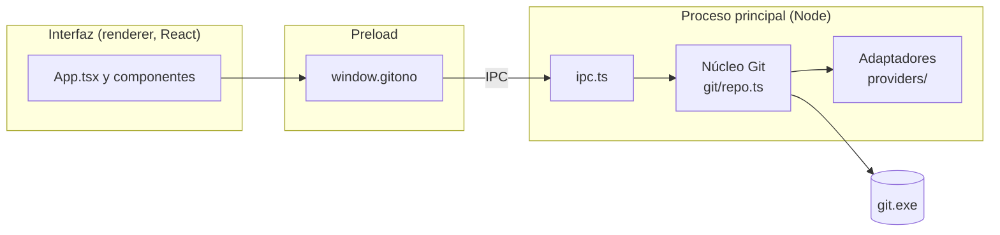

# Arquitectura de GitOno

## Tecnologías

| Parte | Elección | Por qué |
|---|---|---|
| App de escritorio | Electron | Todo el proyecto en TypeScript; acceso a Git y al sistema de archivos. |
| Compilación | electron-vite (Vite) | Un solo comando para los tres procesos de Electron, con recarga en caliente. |
| Interfaz | React | Componentes simples y ecosistema conocido. |
| Visor de diferencias | Monaco Editor | Es el editor de VS Code: diff lado a lado, resaltado de sintaxis, textos en español. Se carga desde `node_modules`, sin CDN, así funciona sin internet. |
| Git | El `git` instalado en la máquina | Es la implementación de referencia: soporta todo (renombres, LFS, credenciales) sin reimplementar nada. |
| Tests | Vitest | Rápido y compatible con Vite. |

## Los tres procesos de Electron



- **Interfaz (renderer):** React. No tiene acceso a Node ni al disco; solo puede llamar a `window.gitono`.
- **Preload:** expone una API chica y tipada (`GitOnoApi` en `src/shared/types.ts`) usando `contextBridge`.
- **Proceso principal:** recibe los pedidos por IPC, ejecuta Git y devuelve el resultado.

Los errores viajan como `{ ok: false, error }` y el preload los vuelve a lanzar como `Error` con un mensaje legible, así la interfaz los muestra tal cual.

### Seguridad

- `contextIsolation: true`, `nodeIntegration: false` y `sandbox: true`: la interfaz no puede ejecutar código de Node.
- Política de seguridad de contenido (CSP) en `index.html`: solo se cargan scripts propios.
- Git se ejecuta con `execFile` (sin shell) y cada referencia se valida con `assertSafeRef`, para que un nombre como `--output=x` no se interprete como una opción.
- Los links externos se abren en el navegador del sistema, nunca dentro de la app.

## Capas del proceso principal

### Núcleo Git (`src/main/git/`)

Todo lo que funciona igual con cualquier plataforma. No depende de Electron, así que se puede testear con Node puro.

| Función | Comando Git | Para qué |
|---|---|---|
| `openRepo` | `git rev-parse --show-toplevel`, `git remote get-url` | Encontrar la raíz del repo y su remoto. |
| `listRefs` | `git for-each-ref refs/heads refs/remotes refs/tags` | Listar ramas y tags, de la más reciente a la más vieja. |
| `listRefs` | `git symbolic-ref -q HEAD` | Saber en qué rama está parado el repo. |
| `compareRefs` | `git diff --name-status -z -M A B` | Archivos cambiados y su estado (con detección de renombres). |
| `compareRefs` | `git diff --numstat -z -M A B` | Líneas agregadas y borradas, y qué archivos son binarios. |
| `compareRefs` | `git rev-list --left-right --count A...B` | Cuántos commits tiene cada rama que la otra no. |
| `readFileAtRef` | `git cat-file -s` y `git cat-file blob A:ruta` | Leer un archivo tal como está en una rama, sin checkout. |
| `fetchAll` | `git fetch --all --prune` | Traer ramas nuevas del servidor. |

Decisiones:

- **Se compara A contra B directamente** (`git diff A B`), no contra el ancestro común. La pregunta que responde es "¿en qué se diferencian hoy estas dos ramas?", como comparar dos carpetas.
- **Se usan nombres completos** (`refs/heads/main`) al hablar con Git; los cortos (`main`) solo se muestran. Así no hay ambigüedad si una rama y un tag se llaman igual.
- **Salida con `-z`** (separador NUL): las rutas con espacios, tildes o caracteres especiales llegan tal cual, sin comillas ni escapes.
- **Archivos binarios:** si hay un byte NUL al principio se tratan como binarios (mismo criterio que Git) y no se muestran como texto.
- **Archivos grandes:** más de 5 MB no se cargan en el visor (`MAX_FILE_BYTES`).
- **Credenciales:** `fetch` usa el Git Credential Manager que trae Git para Windows. Se desactiva el pedido de contraseña por terminal (`GIT_TERMINAL_PROMPT=0`) porque la app no tiene terminal.

### Adaptadores de plataforma (`src/main/providers/`)

Cada plataforma implementa la interfaz `GitProvider` (`providers/types.ts`). El resto de la app solo conoce esa interfaz.

- `remote-url.ts` entiende las URLs de remoto (`https://`, `ssh://` y `git@host:ruta`) y extrae el host y la ruta del repo (incluidos los subgrupos de GitLab).
- `github.ts` y `gitlab.ts` deciden si un host les pertenece. GitLab también reconoce instancias propias con "gitlab" en el dominio (por ejemplo `gitlab.empresa.com`).
- Si ningún adaptador reconoce el host, el repo se marca como `generic`: todo lo local funciona igual.

Hoy los adaptadores solo identifican la plataforma. En la etapa 2 la interfaz va a sumar operaciones contra la API de cada plataforma, con la misma firma para todas:

```ts
listBranches(repo): Promise<Branch[]>
compare(repo, base, head): Promise<FileChange[]>
getFile(repo, ref, path): Promise<string>
listChangeRequests(repo): Promise<ChangeRequest[]> // PR en GitHub, MR en GitLab
```

#### Cómo sumar una plataforma nueva

1. Crear `src/main/providers/<plataforma>.ts` que exporte un objeto `GitProvider`.
2. Agregarlo a la lista `providers` en `src/main/providers/index.ts`.
3. Sumar casos en `providers.test.ts`.

## Interfaz (`src/renderer/src/`)

- `App.tsx`: estado general (repo, ramas A y B, comparación, archivo elegido) y estructura de la pantalla.
- `components/RefSelect.tsx`: selector de rama agrupado en locales, remotas y tags.
- `components/FileTree.tsx`: árbol de archivos cambiados. Las carpetas con un solo hijo se compactan (`src/main/git`), como en VS Code.
- `components/DiffView.tsx`: visor Monaco. El editor se crea una sola vez; al cambiar de archivo solo se reemplazan los modelos, así no parpadea.
- `monaco.ts`: configuración de Monaco (workers locales, idioma español, sin validaciones porque es de solo lectura, tema según Windows).
- `lib/settings.ts`: preferencias guardadas (ancho del panel, opciones del diff). Si el almacenamiento falla, se usan los valores por defecto.

Los estados de archivo usan símbolos (+, −, ~, →) en lugar de las letras de Git (A, M, D) para no confundirlos con "rama A" y "rama B".

## Tests

- `git/parse.test.ts`: parsers de la salida de Git.
- `git/repo.test.ts`: crea un repo real en una carpeta temporal, con dos ramas, y prueba el núcleo completo (renombres, binarios, archivos borrados, referencias inválidas).
- `providers/providers.test.ts`: lectura de URLs y detección de plataforma.
- `renderer/src/lib/tree.test.ts`: armado del árbol de archivos.
